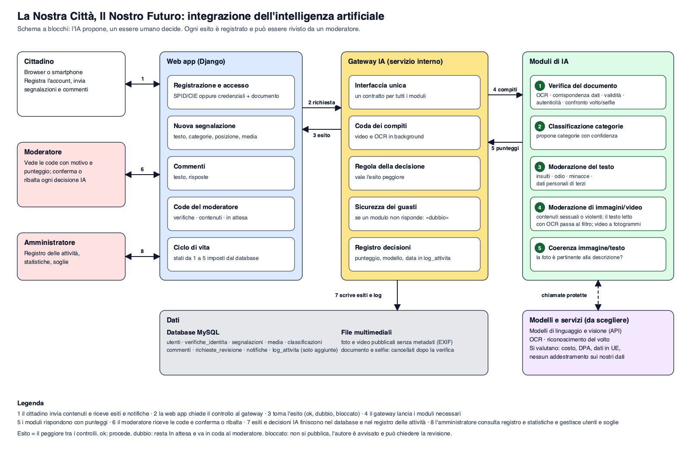
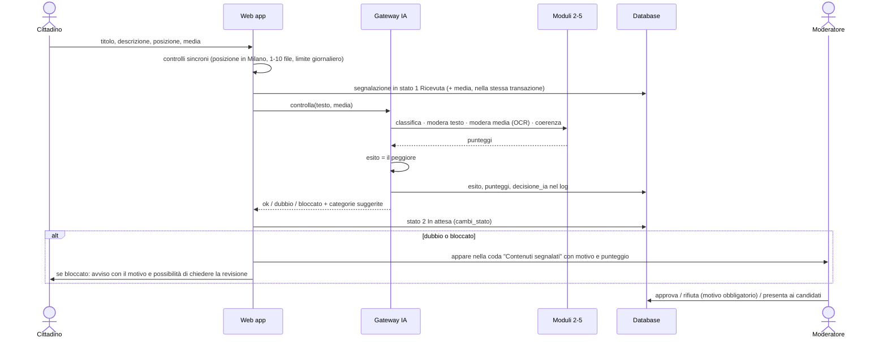

# Integrazione dell'intelligenza artificiale (materiale 3)

Schema a blocchi: [`architettura_ia.png`](architettura_ia.png) (sorgente vettoriale [`architettura_ia.svg`](architettura_ia.svg), generato da `tools/ia/schema_blocchi.py`).



## Principi

1. **L'IA propone, una persona decide.** Ogni decisione automatica si può rivedere: il moderatore conferma o ribalta, l'utente può sempre chiedere la revisione (GDPR, art. 22).
2. **Esito = il peggiore tra i controlli** (`ok` < `dubbio` < `bloccato`). Un controllo che non risponde vale `dubbio`: nel dubbio decide una persona, mai il silenzio.
3. **Tutto è tracciabile.** Punteggio, esito, modello e data finiscono nel database e in `log_attivita` (operazione `decisione_ia`, attore `sistema`). Solo aggiunte: lo garantiscono i trigger.
4. **Minimizzazione dei dati.** Documento e selfie si cancellano appena finita la verifica; dei file si tengono solo esito e punteggio. I metadati (EXIF) si tolgono prima della pubblicazione. Al fornitore si invia solo il necessario.
5. **Un'interfaccia unica.** La web app non conosce i fornitori: parla con il gateway, che offre un contratto per compito. Cambiare modello non tocca il resto.

## I blocchi

| Blocco | Ruolo |
|---|---|
| Web app (Django) | riceve contenuti, chiama il gateway, mostra l'esito, gestisce code e ciclo di vita (`transizioni_ammesse` + trigger) |
| Gateway IA | un'unica interfaccia, coda dei compiti lenti (video, OCR), regola dell'esito peggiore, gestione dei guasti, registro delle decisioni |
| 1 Verifica del documento | OCR · corrispondenza dei dati col modulo · validità e codici di controllo · autenticità · confronto volto/selfie → punteggio 0-100 |
| 2 Classificazione | propone una o più categorie con confidenza |
| 3 Moderazione del testo | insulti, linguaggio volgare, odio, minacce, dati personali di terzi (telefoni, targhe) |
| 4 Moderazione di immagini e video | contenuti sessuali o violenti; per i video, fotogrammi campione; **OCR** del testo nell'immagine che poi passa dal modulo 3 |
| 5 Coerenza immagine/testo | la foto è pertinente alla descrizione e alla categoria? |
| Modelli e servizi | fornitori di modelli di linguaggio, visione, OCR e riconoscimento del volto: da scegliere |
| Dati | MySQL, file multimediali, area temporanea per documento e selfie |

## Flussi

### A. Invio di una segnalazione



Con `bloccato` la segnalazione non viene pubblicata; con `dubbio` resta In attesa e il moderatore vede il problema rilevato. Le categorie suggerite si mostrano già selezionate: l'utente le conferma o le cambia e il sistema registra se le ha scelte l'IA, l'utente o un moderatore (`classificazioni.origine`), così si misura nel tempo la precisione del modello.

### B. Verifica del documento (facoltativa alla registrazione, necessaria per pubblicare)

```mermaid
sequenceDiagram
    actor U as Cittadino
    participant W as Web app
    participant G as Gateway IA
    participant V as Modulo 1
    participant D as Database
    actor O as Moderatore
    U->>W: dati + fronte/retro del documento + selfie dal vivo
    W->>W: salva le immagini in un'area temporanea cifrata
    W->>G: verifica(documento, selfie, dati del modulo)
    G->>V: OCR, corrispondenza, validità, autenticità, volto
    V-->>G: cinque esiti + punteggio
    G->>D: verifiche_identita + decisione_ia nel log
    G-->>W: approvata (>=85) / da_rivedere (50-84) / rifiutata (<50)
    W->>W: cancella immagini e selfie
    alt da_rivedere
        W->>O: coda "Verifiche da rivedere" (stato dei controlli e punteggio)
        O->>D: conferma o ribalta, con motivo
    else rifiutata
        W->>U: motivo; fino a 3 tentativi; richiesta di revisione sempre possibile
    end
```

L'account diventa **attivo** con la conferma dell'email; la verifica approvata rende l'utente **verificato** e gli permette di pubblicare segnalazioni. Con SPID/CIE non serve alcun controllo IA: l'identità è già certificata.

### C. Commento

Testo → modulo 3. `ok` si pubblica; `dubbio` si pubblica e va in coda al moderatore; `bloccato` non si pubblica e l'autore riceve il motivo.

## Regole di decisione

| Verifica documento | Esito |
|---|---|
| punteggio ≥ 85 | approvata |
| 50 - 84 | da rivedere (coda del moderatore) |
| < 50 | rifiutata (l'utente riceve il motivo e può riprovare, al massimo 3 volte) |

| Contenuto (testo, media, coerenza) | Esito | Conseguenza |
|---|---|---|
| nessun problema | `ok` | prosegue nel ciclo di vita |
| problema incerto | `dubbio` | resta In attesa, coda del moderatore con il motivo |
| contenuto grave (sessuale, violento, d'odio, minacce) | `bloccato` | non si pubblica, l'autore è avvisato e può chiedere la revisione |

Le soglie vanno **tarate sui dati reali**: per questo ogni punteggio è salvato (`punteggio_moderazione`, `punteggio_coerenza`, `punteggio_sessuale`, `punteggio_violenza`, `verifiche_identita.punteggio`) e il pannello amministratore mostra la quota di decisioni dell'IA ribaltate dai moderatori.

## Guasti e limiti

- **Timeout o errore di un modulo:** esito `dubbio`, con motivo «controllo non disponibile»; la segnalazione non si perde e non si pubblica da sola.
- **Compiti lenti** (video, OCR): in coda, la segnalazione resta Ricevuta finché non sono finiti.
- **Falsi positivi e falsi negativi:** nessun modello è perfetto. Per questo l'esito peggiore non basta: la revisione umana è sempre disponibile e le decisioni ribaltate si contano.
- **Richieste al fornitore:** con limite di frequenza e nuovo tentativo con attesa crescente. Un'interruzione del fornitore rallenta le pubblicazioni (tutto va in coda al moderatore) ma non blocca l'accesso al sito.

## Protezione dei dati

| Tema | Scelta |
|---|---|
| Dati biometrici (art. 9) | consenso esplicito solo nel percorso con credenziali; il volto serve solo al confronto con il selfie |
| Decisioni automatiche (art. 22) | informativa dedicata; revisione umana sempre richiedibile |
| Documento e selfie | area temporanea cifrata, cancellati a verifica conclusa; si conservano esito, punteggio, data e revisore |
| Fornitori | accordo di trattamento dei dati, dati in UE se possibile, nessun addestramento sui nostri dati, valutazione d'impatto (DPIA) prima dell'uso reale |
| Metadati dei media | EXIF e dati del dispositivo rimossi prima della pubblicazione |

## Dove sta nel progetto

| Elemento | Oggi |
|---|---|
| Esiti e punteggi | colonne `esito_moderazione`, `punteggio_*`, `esito_visione`, `testo_ocr`, `esito_testo_ocr` in `segnalazioni`, `media`, `commenti`; `verifiche_identita` |
| Origine delle categorie | `classificazioni.origine` (`ia`, `utente`, `moderatore`) e `confidenza`: le categorie le sceglie l'autore, con il suggerimento locale per parole chiave |
| Registro | `log_attivita` con operazione `decisione_ia`: esito, motivazione, segnali, modello, versione del prompt; una riga anche per ogni richiesta a OpenRouter |
| Code del moderatore | `/moderazione/`, con motivazione e segnali accanto a ogni contenuto segnalato |
| Controlli su testi e foto | **veri, con modelli gratuiti di OpenRouter** (`core/services/ia/openrouter.py`), dopo un **prefiltro locale** senza IA (`prefiltro.py`). Piano e decisioni: [`piano_ia_openrouter.md`](piano_ia_openrouter.md); prove dei modelli: [`ia_sonda_modelli.md`](ia_sonda_modelli.md); taratura: [`ia_taratura.md`](ia_taratura.md). Spenti per impostazione (`IA_MODALITA=sincrona`, simulato) |
| Coda e lavoratore | tabella tecnica `coda_ia` (migrazione 006), `coda.py`, `lavoratore.py`; quota giornaliera in `quota.py`; pannello `/amministrazione/ia/` |
| Foto e video | `immagini.py`: fino a 5 immagini da 768 px per segnalazione (dei video 2 fotogrammi), volti sfocati e testo delle foto letto in locale prima dell'invio |
| Verifica del documento | **controlli veri e locali**, mai inviati a un fornitore esterno: `core/services/ia/documento_reale.py` (OCR con Tesseract, zona a lettura ottica con codici di controllo in `mrz.py`, confronto dei dati col modulo, validità, volto con OpenCV YuNet+SFace). Se Tesseract o i modelli mancano si usa il simulato (`IA_DOCUMENTO`) |

## Come funziona oggi (con `IA_MODALITA=coda`)

1. **Prefiltro locale** (Python, nessuna richiesta): normalizza il testo e cerca minacce e auguri di morte (→ `bloccato`), insulti anche scritti male, tono ostile, accuse a persone, telefoni, email, targhe, codici fiscali e IBAN validi, indirizzi di casa, spam, testi ripetitivi, doppioni. Decide se il contenuto va al modello.
2. **Salvataggio e coda**: il contenuto si salva subito e l'utente lo vede «In attesa»; se serve il modello entra in `coda_ia` con una priorità pari al rischio.
3. **Lavoratore in background**: una richiesta alla volta, distanziata, nel rispetto della quota (50 richieste al giorno nel piano gratuito, 36 per le segnalazioni, 8 per i commenti). Una segnalazione costa 1 richiesta (testo e fino a 5 immagini); i commenti si mandano a blocchi fino a 25.
4. **Esito**: il modello risponde solo con un JSON a schema fisso (`approvato`, `motivazione` di poche parole, per le foto anche `coerente` e `problema`). Può solo **peggiorare** l'esito: `ok` oppure `dubbio`; `bloccato` lo dà soltanto il prefiltro. Se non risponde, dopo 3 tentativi o 24 ore l'esito è `dubbio` e decide il moderatore, che non può approvare finché manca l'esito.
5. **Commenti «puliti»** per il prefiltro sono pubblicati con esito `ok` e riletti dal modello con la quota avanzata (`IA_RILEGGI_PULITI`): se il modello li giudica non approvati diventano `dubbio`.

## Passi per l'IA vera

1. ~~Interfaccia unica~~ **fatto**: `core/services/ia/__init__.py`.
2. ~~Scegliere i fornitori~~ **fatto**: OpenRouter, modelli gratuiti, nessuna spesa. Con la privacy `data_collection = "deny"` i modelli utilizzabili sono pochi e cambiano: stanno in configurazione (`IA_MODELLI_TESTO`, `IA_MODELLI_VISIONE`).
3. ~~Coda e lavoratore~~ **fatto**.
4. ~~Modello e versione nelle decisioni~~ **fatto** (registro).
5. Tarare le soglie su contenuti etichettati: **in corso**, vedi [`ia_taratura.md`](ia_taratura.md).
6. Da fare quando serve: un fornitore a pagamento con accordo di trattamento dei dati (DPA) e dati in UE; la valutazione d'impatto (DPIA); un controllo dei volti con più modelli.
