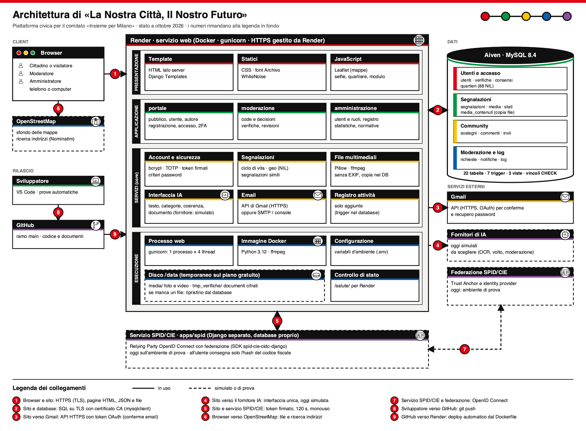
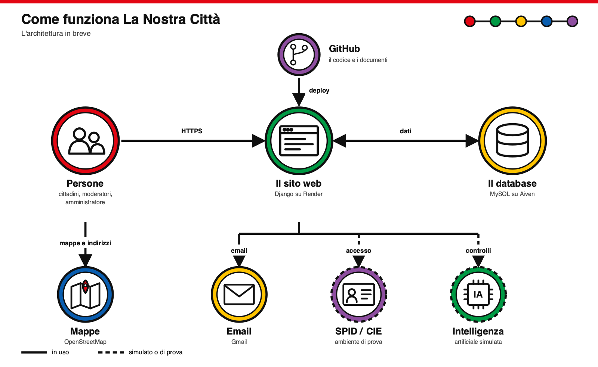

# Architettura del sistema

Versione semplificata, a icone: [`architettura_lite.png`](architettura_lite.png) (sorgente `architettura_lite.svg`, generata da `tools/architettura/disegna_lite.py`).

Sorgente vettoriale: [`architettura_sistema.svg`](architettura_sistema.svg). Il disegno è generato da `tools/architettura/disegna.py`: per aggiornarlo si modifica lo script e si rilancia (`DYLD_FALLBACK_LIBRARY_PATH=/opt/homebrew/lib tools/.venv/bin/python tools/architettura/disegna.py`). Per lo schema a blocchi dell'intelligenza artificiale vedi [`architettura_ia.md`](architettura_ia.md).

Il disegno è a **livelli** (presentazione, applicazione, servizi, esecuzione) dentro il servizio su Render, con i dati a destra, i servizi esterni sotto e il client a sinistra. I numeri rossi sulle frecce rimandano alla legenda in fondo al disegno, che indica il protocollo di ogni collegamento. Tratto pieno = in uso; tratteggiato = simulato o di prova. Le forme richiamano la funzione: il database è un cilindro, il browser una finestra, il servizio su Render un server; nelle intestazioni compaiono le icone di email, mappa, intelligenza artificiale, SPID/CIE, disco, contenitore Docker e GitHub.

## I blocchi

| Blocco | Cosa è | Dove |
|---|---|---|
| Browser | cittadini, moderatori e amministratori accedono dal browser (telefono o computer) | |
| Sito Django | un'unica applicazione con tre aree (`portale`, `moderazione`, `amministrazione`) e i servizi condivisi in `core/` | `apps/web/`, ospitato su Render (immagine Docker) |
| Database | MySQL 8.4 su Aiven; schema dalle migrazioni SQL; 22 tabelle, 7 trigger, 3 viste | `db/`, `docs/modello_logico.md` |
| File caricati | foto e video su disco, con copia nel database (`media_contenuti`) per i dischi temporanei | `apps/web/core/services/media.py`, `archivio_media.py` |
| Servizio SPID/CIE | Django separato con l'SDK OpenID Connect; consegna l'identità al sito con un token firmato | `apps/spid/` |
| Email | SMTP (Gmail con password per le app) per conferma dell'indirizzo e recupero password | `core/services/email.py`, `docs/produzione.md` |
| Intelligenza artificiale | un'interfaccia unica con un fornitore simulato; i fornitori veri sono da scegliere | `core/services/ia/`, `docs/architettura_ia.md` |
| Mappe | le mappe fanno parte del sito (Leaflet, segnaposto dal database, confini dei quartieri); solo lo sfondo e la ricerca degli indirizzi arrivano da OpenStreetMap, chiamati dal browser | `apps/web/static/js/` |
| Rilascio | commit su GitHub, deploy automatico su Render con il `Dockerfile` | `render.yaml`, `apps/web/Dockerfile` |

## Flussi principali

1. **Registrazione**: modulo, database, email di conferma, account attivo. La verifica del documento è facoltativa e necessaria solo per pubblicare.
2. **Accesso con SPID/CIE**: il sito manda l'utente al servizio SPID, che parla con la federazione; al ritorno consegna al sito un token firmato (120 secondi, monouso). Del codice fiscale si salva solo l'hash.
3. **Segnalazione**: modulo con foto e video, controlli IA (simulati), stato «In attesa», decisione del moderatore, pubblicazione, presentazione ai candidati. Ogni passaggio finisce nel registro delle attività.

## Cosa è simulato o di prova

La verifica del documento e la moderazione IA sono simulate; SPID/CIE usa l'ambiente di prova della federazione; le foto dei dati demo sono illustrazioni. Il disco di Render nel piano gratuito è temporaneo.
