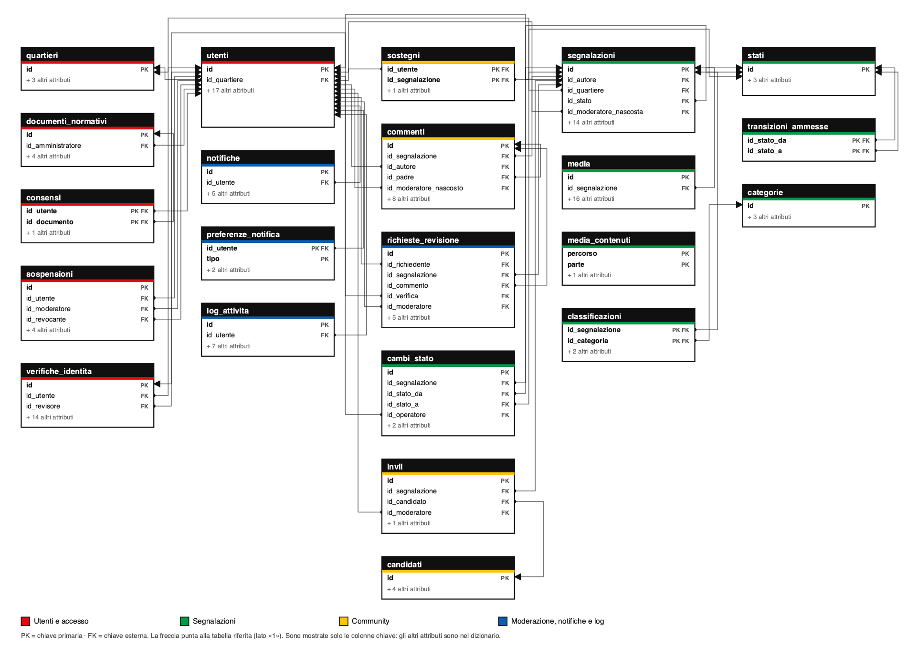

# Modello logico

Progetto: La Nostra Città, Il Nostro Futuro

Il modello logico traduce il modello ER ([`modello_er.md`](modello_er.md)) in uno schema relazionale per **MySQL 8**. È generato da [`db/schema.sql`](../db/schema.sql) con `tools/logico/genera.py`: non si modifica a mano, si rigenera. Lo schema fisico (tipi, trigger, viste, dati iniziali) è in `db/schema.sql`; il diagramma è [`modello_logico.png`](modello_logico.png) (sorgente vettoriale [`modello_logico.svg`](modello_logico.svg)).

## Notazione

- <u>sottolineato</u> = chiave primaria (PK); *corsivo* = chiave esterna (FK); <u>*sottolineato e corsivo*</u> = chiave primaria che è anche chiave esterna.
- Le tabelle sono al plurale e in `snake_case`, come richiede la regola del progetto. Nell'ER le stesse cose sono entità al singolare.

## Schema relazionale

### Utenti e accesso

**QUARTIERI** ( <u>id</u>, nome, municipio, confine )

**UTENTI** ( <u>id</u>, nome, cognome, email, password_hash, codice_fiscale_hash, data_nascita, metodo_registrazione, ruolo, stato_account, *id_quartiere*, profilo_pubblico, mfa_attiva, mfa_segreto, tentativi_falliti, bloccato_fino, email_verificata_il, creato_il, eliminato_il )

**VERIFICHE_IDENTITA** ( <u>id</u>, *id_utente*, tentativo, tipo_documento, ok_lettura_ocr, ok_corrispondenza_dati, ok_validita, ok_autenticita, ok_confronto_volto, punteggio, esito_ia, motivo, *id_revisore*, esito_finale, motivo_revisione, revisionata_il, creata_il )

**SOSPENSIONI** ( <u>id</u>, *id_utente*, *id_moderatore*, motivo, inizio, fine, revocata_il, *id_revocante* )

**DOCUMENTI_NORMATIVI** ( <u>id</u>, tipo, versione, testo, pubblicato_il, *id_amministratore* )

**CONSENSI** ( <u>*id_utente*</u>, <u>*id_documento*</u>, accettato_il )

### Segnalazioni

**STATI** ( <u>id</u>, nome, finale, pubblico )

**TRANSIZIONI_AMMESSE** ( <u>*id_stato_da*</u>, <u>*id_stato_a*</u> )

**CATEGORIE** ( <u>id</u>, nome, descrizione, attiva )

**SEGNALAZIONI** ( <u>id</u>, *id_autore*, tipo, titolo, descrizione, latitudine, longitudine, indirizzo, *id_quartiere*, *id_stato*, esito_moderazione, punteggio_moderazione, punteggio_coerenza, nascosta, motivo_nascosta, *id_moderatore_nascosta*, creata_il, aggiornata_il, eliminata_il )

**MEDIA** ( <u>id</u>, *id_segnalazione*, tipo, percorso, mime_type, dimensione_byte, durata_sec, ordine, copertina, copertina_di, exif_lat, exif_lon, esito_visione, punteggio_sessuale, punteggio_violenza, testo_ocr, esito_testo_ocr, caricato_il )

**MEDIA_CONTENUTI** ( <u>percorso</u>, <u>parte</u>, dati )

**CLASSIFICAZIONI** ( <u>*id_segnalazione*</u>, <u>*id_categoria*</u>, origine, confidenza )

**CAMBI_STATO** ( <u>id</u>, *id_segnalazione*, *id_stato_da*, *id_stato_a*, *id_operatore*, nota, avvenuto_il )

### Community

**SOSTEGNI** ( <u>*id_utente*</u>, <u>*id_segnalazione*</u>, creato_il )

**COMMENTI** ( <u>id</u>, *id_segnalazione*, *id_autore*, *id_padre*, testo, esito_moderazione, punteggio_moderazione, nascosto, motivo_nascosto, *id_moderatore_nascosto*, creato_il, modificato_il, eliminato_il )

**CANDIDATI** ( <u>id</u>, nome, cognome, lista, email )

**INVII** ( <u>id</u>, *id_segnalazione*, *id_candidato*, *id_moderatore*, inviato_il )

### Moderazione, notifiche e log

**RICHIESTE_REVISIONE** ( <u>id</u>, *id_richiedente*, *id_segnalazione*, *id_commento*, *id_verifica*, motivo, stato, *id_moderatore*, risposta, creata_il, chiusa_il )

**NOTIFICHE** ( <u>id</u>, *id_utente*, tipo, messaggio, link, letta, creata_il )

**PREFERENZE_NOTIFICA** ( <u>*id_utente*</u>, <u>tipo</u>, in_app, email )

**LOG_ATTIVITA** ( <u>id</u>, avvenuto_il, attore, *id_utente*, operazione, tabella, id_oggetto, dati_precedenti, dati_nuovi )

## Dizionario delle tabelle

### Utenti e accesso

#### `quartieri`

I 88 Nuclei di Identità Locale (NIL) di Milano, con il confine in GeoJSON.

| Colonna | Tipo | Null | Note |
|---|---|---|---|
| `id` | `SMALLINT` | no | PK; auto-incremento |
| `nome` | `VARCHAR(100)` | no | UNIQUE |
| `municipio` | `SMALLINT` | no |  |
| `confine` | `JSON` | sì |  |

Vincoli CHECK:

- `chk_municipio`: `municipio BETWEEN 1 AND 9`

#### `utenti`

Persone registrate, con ruolo e stato dell'account separati; per SPID/CIE si conserva solo l'hash del codice fiscale.

| Colonna | Tipo | Null | Note |
|---|---|---|---|
| `id` | `INT` | no | PK; auto-incremento |
| `nome` | `VARCHAR(50)` | no |  |
| `cognome` | `VARCHAR(50)` | no |  |
| `email` | `VARCHAR(254)` | no | UNIQUE |
| `password_hash` | `VARCHAR(255)` | sì |  |
| `codice_fiscale_hash` | `CHAR(64)` | sì | UNIQUE |
| `data_nascita` | `DATE` | no |  |
| `metodo_registrazione` | `ENUM('credenziali','spid','cie')` | no |  |
| `ruolo` | `ENUM('utente','moderatore','amministratore')` | no | default 'utente' |
| `stato_account` | `ENUM('in_attesa_verifica','attivo','sospeso','eliminato')` | no | default 'in_attesa_verifica' |
| `id_quartiere` | `SMALLINT` | sì | FK → `quartieri.id` |
| `profilo_pubblico` | `BOOLEAN` | no | default FALSE |
| `mfa_attiva` | `BOOLEAN` | no | default FALSE |
| `mfa_segreto` | `VARCHAR(255)` | sì |  |
| `tentativi_falliti` | `SMALLINT` | no | default 0 |
| `bloccato_fino` | `DATETIME(3)` | sì |  |
| `email_verificata_il` | `DATETIME(3)` | sì |  |
| `creato_il` | `DATETIME(3)` | no | default CURRENT_TIMESTAMP(3) |
| `eliminato_il` | `DATETIME(3)` | sì |  |

Vincoli CHECK:

- `chk_email`: `REGEXP_LIKE(email, '^[^@[:space:]]+@[^@[:space:]]+\\.[^@[:space:]]+$')`
- `chk_tentativi`: `tentativi_falliti >= 0`
- `chk_password_solo_credenziali`: `(metodo_registrazione = 'credenziali') = (password_hash IS NOT NULL)`
- `chk_cf_solo_spid_cie`: `(metodo_registrazione IN ('spid','cie')) = (codice_fiscale_hash IS NOT NULL)`
- `chk_mfa_segreto`: `NOT mfa_attiva OR mfa_segreto IS NOT NULL`
- `chk_eliminato`: `(stato_account = 'eliminato') = (eliminato_il IS NOT NULL)`

#### `verifiche_identita`

Tentativi di verifica del documento (al massimo 3 per utente): cinque controlli, punteggio, esito dell'IA ed eventuale revisione umana.

| Colonna | Tipo | Null | Note |
|---|---|---|---|
| `id` | `INT` | no | PK; auto-incremento |
| `id_utente` | `INT` | no | FK → `utenti.id` |
| `tentativo` | `SMALLINT` | no |  |
| `tipo_documento` | `ENUM('carta_identita','patente','passaporto')` | no |  |
| `ok_lettura_ocr` | `BOOLEAN` | no |  |
| `ok_corrispondenza_dati` | `BOOLEAN` | no |  |
| `ok_validita` | `BOOLEAN` | no |  |
| `ok_autenticita` | `BOOLEAN` | no |  |
| `ok_confronto_volto` | `BOOLEAN` | no |  |
| `punteggio` | `SMALLINT` | no |  |
| `esito_ia` | `ENUM('approvata','da_rivedere','rifiutata')` | no |  |
| `motivo` | `TEXT` | sì |  |
| `id_revisore` | `INT` | sì | FK → `utenti.id` |
| `esito_finale` | `ENUM('approvata','da_rivedere','rifiutata')` | sì |  |
| `motivo_revisione` | `TEXT` | sì |  |
| `revisionata_il` | `DATETIME(3)` | sì |  |
| `creata_il` | `DATETIME(3)` | no | default CURRENT_TIMESTAMP(3) |

Vincoli di unicità e indici: UNIQUE `uq_verifica_tentativo` (id_utente, tentativo).

Vincoli CHECK:

- `chk_tentativo`: `tentativo BETWEEN 1 AND 3`
- `chk_punteggio`: `punteggio BETWEEN 0 AND 100`
- `chk_esito_da_punteggio`: `(punteggio >= 85 AND esito_ia = 'approvata') OR (punteggio BETWEEN 50 AND 84 AND esito_ia = 'da_rivedere') OR (punteggio < 50 AND esito_ia = 'rifiutata')`
- `chk_revisione_completa`: `(id_revisore IS NULL AND esito_finale IS NULL AND revisionata_il IS NULL) OR (id_revisore IS NOT NULL AND esito_finale IN ('approvata','rifiutata') AND revisionata_il IS NOT NULL)`

#### `sospensioni`

Periodi di sospensione di un account, con motivo e moderatore.

| Colonna | Tipo | Null | Note |
|---|---|---|---|
| `id` | `INT` | no | PK; auto-incremento |
| `id_utente` | `INT` | no | FK → `utenti.id` |
| `id_moderatore` | `INT` | no | FK → `utenti.id` |
| `motivo` | `TEXT` | no |  |
| `inizio` | `DATETIME(3)` | no | default CURRENT_TIMESTAMP(3) |
| `fine` | `DATETIME(3)` | sì |  |
| `revocata_il` | `DATETIME(3)` | sì |  |
| `id_revocante` | `INT` | sì | FK → `utenti.id` |

Vincoli CHECK:

- `chk_sosp_fine`: `fine IS NULL OR fine > inizio`
- `chk_sosp_se_stesso`: `id_utente <> id_moderatore`
- `chk_sosp_revoca`: `(revocata_il IS NULL) = (id_revocante IS NULL)`

#### `documenti_normativi`

Versioni dei testi normativi (privacy, biometrici, IA, termini, cookie, età minima).

| Colonna | Tipo | Null | Note |
|---|---|---|---|
| `id` | `SMALLINT` | no | PK; auto-incremento |
| `tipo` | `ENUM('privacy','biometrici','intelligenza_artificiale','termini_uso','cookie','eta_minima')` | no |  |
| `versione` | `VARCHAR(20)` | no |  |
| `testo` | `MEDIUMTEXT` | no |  |
| `pubblicato_il` | `DATETIME(3)` | no | default CURRENT_TIMESTAMP(3) |
| `id_amministratore` | `INT` | no | FK → `utenti.id` |

Vincoli di unicità e indici: UNIQUE `uq_documento_versione` (tipo, versione).

#### `consensi`

Quale versione di quale documento ha accettato ogni utente (associazione N:N con data).

| Colonna | Tipo | Null | Note |
|---|---|---|---|
| `id_utente` | `INT` | no | PK (composta); FK → `utenti.id` |
| `id_documento` | `SMALLINT` | no | PK (composta); FK → `documenti_normativi.id` |
| `accettato_il` | `DATETIME(3)` | no | default CURRENT_TIMESTAMP(3) |

### Segnalazioni

#### `stati`

I cinque stati del ciclo di vita di una segnalazione.

| Colonna | Tipo | Null | Note |
|---|---|---|---|
| `id` | `SMALLINT` | no | PK |
| `nome` | `VARCHAR(30)` | no | UNIQUE |
| `finale` | `BOOLEAN` | no | default FALSE |
| `pubblico` | `BOOLEAN` | no | default FALSE |

#### `transizioni_ammesse`

Passaggi consentiti tra stati: li impone un trigger.

| Colonna | Tipo | Null | Note |
|---|---|---|---|
| `id_stato_da` | `SMALLINT` | no | PK (composta); FK → `stati.id` |
| `id_stato_a` | `SMALLINT` | no | PK (composta); FK → `stati.id` |

Vincoli CHECK:

- `chk_trans_diversi`: `id_stato_da <> id_stato_a`

#### `categorie`

Categorie tematiche (ambiente, mobilità, decoro, sicurezza, giovani) attivabili dall'amministratore.

| Colonna | Tipo | Null | Note |
|---|---|---|---|
| `id` | `SMALLINT` | no | PK; auto-incremento |
| `nome` | `VARCHAR(50)` | no | UNIQUE |
| `descrizione` | `TEXT` | sì |  |
| `attiva` | `BOOLEAN` | no | default TRUE |

#### `segnalazioni`

Segnalazioni e proposte dei cittadini, con posizione, stato, esito della moderazione IA ed eliminazione logica.

| Colonna | Tipo | Null | Note |
|---|---|---|---|
| `id` | `INT` | no | PK; auto-incremento |
| `id_autore` | `INT` | no | FK → `utenti.id` |
| `tipo` | `ENUM('proposta','problema')` | no |  |
| `titolo` | `VARCHAR(100)` | no |  |
| `descrizione` | `TEXT` | no |  |
| `latitudine` | `DECIMAL(9,6)` | no |  |
| `longitudine` | `DECIMAL(9,6)` | no |  |
| `indirizzo` | `VARCHAR(255)` | sì |  |
| `id_quartiere` | `SMALLINT` | no | FK → `quartieri.id` |
| `id_stato` | `SMALLINT` | no | FK → `stati.id`; default 1 |
| `esito_moderazione` | `ENUM('ok','dubbio','bloccato')` | sì |  |
| `punteggio_moderazione` | `DECIMAL(4,3)` | sì |  |
| `punteggio_coerenza` | `DECIMAL(4,3)` | sì |  |
| `nascosta` | `BOOLEAN` | no | default FALSE |
| `motivo_nascosta` | `TEXT` | sì |  |
| `id_moderatore_nascosta` | `INT` | sì | FK → `utenti.id` |
| `creata_il` | `DATETIME(3)` | no | default CURRENT_TIMESTAMP(3) |
| `aggiornata_il` | `DATETIME(3)` | sì |  |
| `eliminata_il` | `DATETIME(3)` | sì |  |

Vincoli di unicità e indici: indice `idx_segnalazioni_quartiere_stato` (id_quartiere, id_stato).

Vincoli CHECK:

- `chk_descrizione`: `CHAR_LENGTH(descrizione) BETWEEN 30 AND 2000`
- `chk_latitudine`: `latitudine BETWEEN 45.38 AND 45.54`
- `chk_longitudine`: `longitudine BETWEEN 9.04 AND 9.28`
- `chk_segn_punteggio_mod`: `punteggio_moderazione BETWEEN 0 AND 1`
- `chk_segn_punteggio_coer`: `punteggio_coerenza BETWEEN 0 AND 1`
- `chk_nascosta_con_motivo`: `NOT nascosta OR (motivo_nascosta IS NOT NULL AND id_moderatore_nascosta IS NOT NULL)`

#### `media`

Foto e video allegati (1-10 per segnalazione) con gli esiti dei controlli visivi.

| Colonna | Tipo | Null | Note |
|---|---|---|---|
| `id` | `INT` | no | PK; auto-incremento |
| `id_segnalazione` | `INT` | no | FK → `segnalazioni.id` |
| `tipo` | `ENUM('foto','video')` | no |  |
| `percorso` | `VARCHAR(500)` | no |  |
| `mime_type` | `VARCHAR(50)` | no |  |
| `dimensione_byte` | `INT` | no |  |
| `durata_sec` | `SMALLINT` | sì |  |
| `ordine` | `SMALLINT` | no |  |
| `copertina` | `BOOLEAN` | no | default FALSE |
| `copertina_di` | `INT` | sì |  |
| `exif_lat` | `DECIMAL(9,6)` | sì |  |
| `exif_lon` | `DECIMAL(9,6)` | sì |  |
| `esito_visione` | `ENUM('ok','dubbio','bloccato')` | sì |  |
| `punteggio_sessuale` | `DECIMAL(4,3)` | sì |  |
| `punteggio_violenza` | `DECIMAL(4,3)` | sì |  |
| `testo_ocr` | `TEXT` | sì |  |
| `esito_testo_ocr` | `ENUM('ok','dubbio','bloccato')` | sì |  |
| `caricato_il` | `DATETIME(3)` | no | default CURRENT_TIMESTAMP(3) |

Vincoli di unicità e indici: UNIQUE `uq_media_ordine` (id_segnalazione, ordine); UNIQUE `uq_media_una_copertina` (copertina_di).

Vincoli CHECK:

- `chk_media_ordine`: `ordine BETWEEN 1 AND 10`
- `chk_media_dimensione`: `dimensione_byte > 0`
- `chk_media_punt_sess`: `punteggio_sessuale BETWEEN 0 AND 1`
- `chk_media_punt_viol`: `punteggio_violenza BETWEEN 0 AND 1`
- `chk_limiti_media`: `(tipo = 'foto' AND mime_type IN ('image/jpeg','image/png','image/heic') AND dimensione_byte <= 10485760 AND durata_sec IS NULL) OR (tipo = 'video' AND mime_type IN ('video/mp4','video/quicktime') AND dimensione_byte <= 52428800 AND durata_sec BETWEEN 1 AND 60)`

#### `media_contenuti`

Tabella tecnica (non è un'entità del dominio): copia dei file caricati a pezzi da 4 MB, per ripristinarli se il disco dell'hosting è temporaneo.

| Colonna | Tipo | Null | Note |
|---|---|---|---|
| `percorso` | `VARCHAR(255)` | no | PK (composta) |
| `parte` | `SMALLINT` | no | PK (composta) |
| `dati` | `MEDIUMBLOB` | no |  |

#### `classificazioni`

Categorie assegnate a una segnalazione, con origine (IA, utente, moderatore) e confidenza (associazione N:N).

| Colonna | Tipo | Null | Note |
|---|---|---|---|
| `id_segnalazione` | `INT` | no | PK (composta); FK → `segnalazioni.id` ON DELETE CASCADE |
| `id_categoria` | `SMALLINT` | no | PK (composta); FK → `categorie.id` |
| `origine` | `ENUM('ia','utente','moderatore')` | no |  |
| `confidenza` | `DECIMAL(4,3)` | sì |  |

Vincoli CHECK:

- `chk_confidenza`: `confidenza BETWEEN 0 AND 1`
- `chk_confidenza_solo_ia`: `(origine = 'ia') = (confidenza IS NOT NULL)`

#### `cambi_stato`

Cronologia degli stati di una segnalazione, con chi e quando.

| Colonna | Tipo | Null | Note |
|---|---|---|---|
| `id` | `INT` | no | PK; auto-incremento |
| `id_segnalazione` | `INT` | no | FK → `segnalazioni.id` |
| `id_stato_da` | `SMALLINT` | no | FK → `stati.id` |
| `id_stato_a` | `SMALLINT` | no | FK → `stati.id` |
| `id_operatore` | `INT` | sì | FK → `utenti.id` |
| `nota` | `TEXT` | sì |  |
| `avvenuto_il` | `DATETIME(3)` | no | default CURRENT_TIMESTAMP(3) |

Vincoli di unicità e indici: indice `idx_cambi_stato_segnalazione` (id_segnalazione, avvenuto_il).

### Community

#### `sostegni`

Sostegno di un utente a una segnalazione (associazione N:N, uno per coppia).

| Colonna | Tipo | Null | Note |
|---|---|---|---|
| `id_utente` | `INT` | no | PK (composta); FK → `utenti.id` |
| `id_segnalazione` | `INT` | no | PK (composta); FK → `segnalazioni.id` |
| `creato_il` | `DATETIME(3)` | no | default CURRENT_TIMESTAMP(3) |

Vincoli di unicità e indici: indice `idx_sostegni_segnalazione` (id_segnalazione).

#### `commenti`

Commenti e risposte (stessa segnalazione del commento padre), con esito di moderazione.

| Colonna | Tipo | Null | Note |
|---|---|---|---|
| `id` | `INT` | no | PK; auto-incremento |
| `id_segnalazione` | `INT` | no | FK → `segnalazioni.id` |
| `id_autore` | `INT` | no | FK → `utenti.id` |
| `id_padre` | `INT` | sì | FK → `commenti.id` |
| `testo` | `VARCHAR(1000)` | no |  |
| `esito_moderazione` | `ENUM('ok','dubbio','bloccato')` | sì |  |
| `punteggio_moderazione` | `DECIMAL(4,3)` | sì |  |
| `nascosto` | `BOOLEAN` | no | default FALSE |
| `motivo_nascosto` | `TEXT` | sì |  |
| `id_moderatore_nascosto` | `INT` | sì | FK → `utenti.id` |
| `creato_il` | `DATETIME(3)` | no | default CURRENT_TIMESTAMP(3) |
| `modificato_il` | `DATETIME(3)` | sì |  |
| `eliminato_il` | `DATETIME(3)` | sì |  |

Vincoli di unicità e indici: indice `idx_commenti_segnalazione` (id_segnalazione, creato_il).

Vincoli CHECK:

- `chk_comm_testo`: `CHAR_LENGTH(TRIM(testo)) > 0`
- `chk_comm_punteggio`: `punteggio_moderazione BETWEEN 0 AND 1`
- `chk_comm_nascosto`: `NOT nascosto OR (motivo_nascosto IS NOT NULL AND id_moderatore_nascosto IS NOT NULL)`

#### `candidati`

Candidati Sindaco a cui si presentano le segnalazioni.

| Colonna | Tipo | Null | Note |
|---|---|---|---|
| `id` | `SMALLINT` | no | PK; auto-incremento |
| `nome` | `VARCHAR(50)` | no |  |
| `cognome` | `VARCHAR(50)` | no |  |
| `lista` | `VARCHAR(100)` | no |  |
| `email` | `VARCHAR(254)` | no | UNIQUE |

#### `invii`

Presentazione di una segnalazione a un candidato da parte di un moderatore (associazione ternaria).

| Colonna | Tipo | Null | Note |
|---|---|---|---|
| `id` | `INT` | no | PK; auto-incremento |
| `id_segnalazione` | `INT` | no | FK → `segnalazioni.id` |
| `id_candidato` | `SMALLINT` | no | FK → `candidati.id` |
| `id_moderatore` | `INT` | no | FK → `utenti.id` |
| `inviato_il` | `DATETIME(3)` | no | default CURRENT_TIMESTAMP(3) |

Vincoli di unicità e indici: UNIQUE `uq_invio` (id_segnalazione, id_candidato).

### Moderazione, notifiche e log

#### `richieste_revisione`

Richieste di revisione umana su una segnalazione bloccata, un commento nascosto o una verifica rifiutata.

| Colonna | Tipo | Null | Note |
|---|---|---|---|
| `id` | `INT` | no | PK; auto-incremento |
| `id_richiedente` | `INT` | no | FK → `utenti.id` |
| `id_segnalazione` | `INT` | sì | FK → `segnalazioni.id` |
| `id_commento` | `INT` | sì | FK → `commenti.id` |
| `id_verifica` | `INT` | sì | FK → `verifiche_identita.id` |
| `motivo` | `TEXT` | no |  |
| `stato` | `ENUM('aperta','accolta','respinta')` | no | default 'aperta' |
| `id_moderatore` | `INT` | sì | FK → `utenti.id` |
| `risposta` | `TEXT` | sì |  |
| `creata_il` | `DATETIME(3)` | no | default CURRENT_TIMESTAMP(3) |
| `chiusa_il` | `DATETIME(3)` | sì |  |

Vincoli CHECK:

- `chk_un_solo_oggetto`: `(id_segnalazione IS NOT NULL) + (id_commento IS NOT NULL) + (id_verifica IS NOT NULL) = 1`
- `chk_chiusura`: `(stato = 'aperta') = (chiusa_il IS NULL AND id_moderatore IS NULL)`

#### `notifiche`

Notifiche per utente.

| Colonna | Tipo | Null | Note |
|---|---|---|---|
| `id` | `BIGINT` | no | PK; auto-incremento |
| `id_utente` | `INT` | no | FK → `utenti.id` |
| `tipo` | `ENUM('verifica_account','stato_account','stato_segnalazione','contenuto_bloccato', 'nuovo_commento','risposta_commento','nuova_segnalazione_quartiere','normativa_aggiornata')` | no |  |
| `messaggio` | `VARCHAR(500)` | no |  |
| `link` | `VARCHAR(500)` | sì |  |
| `letta` | `BOOLEAN` | no | default FALSE |
| `creata_il` | `DATETIME(3)` | no | default CURRENT_TIMESTAMP(3) |

Vincoli di unicità e indici: indice `idx_notifiche_utente_letta` (id_utente, letta).

#### `preferenze_notifica`

Per ogni utente e tipo di evento, se riceverlo nell'app e per email.

| Colonna | Tipo | Null | Note |
|---|---|---|---|
| `id_utente` | `INT` | no | PK (composta); FK → `utenti.id` |
| `tipo` | `ENUM('verifica_account','stato_account','stato_segnalazione','contenuto_bloccato', 'nuovo_commento','risposta_commento','nuova_segnalazione_quartiere','normativa_aggiornata')` | no | PK (composta) |
| `in_app` | `BOOLEAN` | no | default TRUE |
| `email` | `BOOLEAN` | no | default FALSE |

Vincoli CHECK:

- `chk_notifiche_obbligatorie`: `tipo NOT IN ('verifica_account','stato_account','normativa_aggiornata') OR in_app`

#### `log_attivita`

Registro delle attività, solo aggiunte (trigger che bloccano UPDATE e DELETE).

| Colonna | Tipo | Null | Note |
|---|---|---|---|
| `id` | `BIGINT` | no | PK; auto-incremento |
| `avvenuto_il` | `DATETIME(3)` | no | default CURRENT_TIMESTAMP(3) |
| `attore` | `ENUM('utente','sistema')` | no |  |
| `id_utente` | `INT` | sì | FK → `utenti.id` |
| `operazione` | `ENUM('accesso','creazione','modifica','eliminazione','commento','sostegno','cambio_stato', 'verifica_identita','decisione_ia','revisione_moderatore','sospensione','cambio_ruolo', 'accettazione_normativa')` | no |  |
| `tabella` | `VARCHAR(50)` | no |  |
| `id_oggetto` | `BIGINT` | no |  |
| `dati_precedenti` | `JSON` | sì |  |
| `dati_nuovi` | `JSON` | sì |  |

Vincoli di unicità e indici: indice `idx_log_oggetto` (tabella, id_oggetto); indice `idx_log_utente` (id_utente, avvenuto_il).

Vincoli CHECK:

- `chk_log_attore`: `(attore = 'utente') = (id_utente IS NOT NULL)`

## Associazioni tra le tabelle (chiavi esterne)

| Da (N) | Colonna | A (1) | Colonna | Azione |
|---|---|---|---|---|
| `utenti` | `id_quartiere` | `quartieri` | `id` | RESTRICT (predefinita) |
| `verifiche_identita` | `id_utente` | `utenti` | `id` | RESTRICT (predefinita) |
| `verifiche_identita` | `id_revisore` | `utenti` | `id` | RESTRICT (predefinita) |
| `sospensioni` | `id_utente` | `utenti` | `id` | RESTRICT (predefinita) |
| `sospensioni` | `id_moderatore` | `utenti` | `id` | RESTRICT (predefinita) |
| `sospensioni` | `id_revocante` | `utenti` | `id` | RESTRICT (predefinita) |
| `documenti_normativi` | `id_amministratore` | `utenti` | `id` | RESTRICT (predefinita) |
| `consensi` | `id_utente` | `utenti` | `id` | RESTRICT (predefinita) |
| `consensi` | `id_documento` | `documenti_normativi` | `id` | RESTRICT (predefinita) |
| `transizioni_ammesse` | `id_stato_da` | `stati` | `id` | RESTRICT (predefinita) |
| `transizioni_ammesse` | `id_stato_a` | `stati` | `id` | RESTRICT (predefinita) |
| `segnalazioni` | `id_autore` | `utenti` | `id` | RESTRICT (predefinita) |
| `segnalazioni` | `id_quartiere` | `quartieri` | `id` | RESTRICT (predefinita) |
| `segnalazioni` | `id_stato` | `stati` | `id` | RESTRICT (predefinita) |
| `segnalazioni` | `id_moderatore_nascosta` | `utenti` | `id` | RESTRICT (predefinita) |
| `media` | `id_segnalazione` | `segnalazioni` | `id` | RESTRICT (predefinita) |
| `classificazioni` | `id_segnalazione` | `segnalazioni` | `id` | ON DELETE CASCADE |
| `classificazioni` | `id_categoria` | `categorie` | `id` | RESTRICT (predefinita) |
| `cambi_stato` | `id_segnalazione` | `segnalazioni` | `id` | RESTRICT (predefinita) |
| `cambi_stato` | `id_stato_da` | `stati` | `id` | RESTRICT (predefinita) |
| `cambi_stato` | `id_stato_a` | `stati` | `id` | RESTRICT (predefinita) |
| `cambi_stato` | `id_operatore` | `utenti` | `id` | RESTRICT (predefinita) |
| `sostegni` | `id_utente` | `utenti` | `id` | RESTRICT (predefinita) |
| `sostegni` | `id_segnalazione` | `segnalazioni` | `id` | RESTRICT (predefinita) |
| `commenti` | `id_segnalazione` | `segnalazioni` | `id` | RESTRICT (predefinita) |
| `commenti` | `id_autore` | `utenti` | `id` | RESTRICT (predefinita) |
| `commenti` | `id_padre` | `commenti` | `id` | RESTRICT (predefinita) |
| `commenti` | `id_moderatore_nascosto` | `utenti` | `id` | RESTRICT (predefinita) |
| `invii` | `id_segnalazione` | `segnalazioni` | `id` | RESTRICT (predefinita) |
| `invii` | `id_candidato` | `candidati` | `id` | RESTRICT (predefinita) |
| `invii` | `id_moderatore` | `utenti` | `id` | RESTRICT (predefinita) |
| `richieste_revisione` | `id_richiedente` | `utenti` | `id` | RESTRICT (predefinita) |
| `richieste_revisione` | `id_segnalazione` | `segnalazioni` | `id` | RESTRICT (predefinita) |
| `richieste_revisione` | `id_commento` | `commenti` | `id` | RESTRICT (predefinita) |
| `richieste_revisione` | `id_verifica` | `verifiche_identita` | `id` | RESTRICT (predefinita) |
| `richieste_revisione` | `id_moderatore` | `utenti` | `id` | RESTRICT (predefinita) |
| `notifiche` | `id_utente` | `utenti` | `id` | RESTRICT (predefinita) |
| `preferenze_notifica` | `id_utente` | `utenti` | `id` | RESTRICT (predefinita) |
| `log_attivita` | `id_utente` | `utenti` | `id` | RESTRICT (predefinita) |

Totale: 39 chiavi esterne tra 22 tabelle.

## Dal modello ER al modello logico

| Costrutto dell'ER | Regola applicata | Risultato |
|---|---|---|
| Entità | una tabella, con la chiave primaria surrogata `id` (intero auto-incrementale), salvo l'entità debole | 16 tabelle «entità» (le altre 5 vengono dalle associazioni) |
| Associazione 1:N | la chiave primaria del lato 1 diventa chiave esterna nel lato N | es. `segnalazioni.id_autore → utenti.id`, `commenti.id_segnalazione → segnalazioni.id` |
| Associazione N:N con attributi | una tabella ponte con chiave primaria composta dalle due chiavi esterne | `sostegni`, `classificazioni`, `consensi`, `transizioni_ammesse` (5 tabelle in tutto con `invii`) |
| Entità debole (esiste solo in funzione di un'altra) | chiave primaria composta che include la chiave dell'entità forte | `preferenze_notifica` (`id_utente`, `tipo`) |
| Associazione ternaria INVIA (segnalazione, candidato, moderatore) | una tabella con le tre chiavi esterne e unicità su (segnalazione, candidato) | `invii` |
| Associazione ricorsiva (risposta a un commento) | chiave esterna verso la stessa tabella | `commenti.id_padre → commenti.id` |
| Associazione ricorsiva su UTENTE (revisore, moderatore) | più chiavi esterne verso `utenti` con ruoli diversi | `verifiche_identita.id_revisore`, `segnalazioni.id_moderatore_nascosta`, `invii.id_moderatore` |
| Associazione «esclusiva» (la richiesta riguarda una cosa sola) | tre chiavi esterne facoltative e un CHECK che ne impone esattamente una | `richieste_revisione` (`chk_un_solo_oggetto`) |
| Attributo multivalore (categorie di una segnalazione) | tabella separata | `classificazioni` |
| Generalizzazione di ruoli (utente, moderatore, amministratore) | una sola tabella con attributo `ruolo` (ENUM), perché gli attributi coincidono | `utenti.ruolo` |

## Normalizzazione

Lo schema è in **terza forma normale** (3FN; per le tabelle con una sola chiave candidata coincide con la forma di Boyce-Codd).

- **1FN**: tutti gli attributi sono atomici. Le categorie di una segnalazione e i consensi dell'utente, che sarebbero attributi multivalore, stanno in tabelle proprie (`classificazioni`, `consensi`). Le due colonne `JSON` (`quartieri.confine`, `log_attivita.dati_*`) contengono un documento opaco che l'applicazione non interroga per campi: sono dati strutturati e non attributi multivalore del dominio.
- **2FN**: nelle tabelle con chiave composta (`sostegni`, `classificazioni`, `consensi`, `preferenze_notifica`, `transizioni_ammesse`) ogni attributo non chiave dipende dall'intera chiave (es. `classificazioni.origine` e `.confidenza` descrivono la coppia segnalazione-categoria, non una delle due).
- **3FN**: nessun attributo non chiave dipende da un altro attributo non chiave. Il quartiere e lo stato non si ripetono come testo: sono chiavi esterne verso `quartieri` e `stati`. Il nome del candidato non si ripete in `invii`.

**Scelte consapevoli (non sono violazioni):**

- `utenti.stato_account` e `utenti.eliminato_il`, `segnalazioni.nascosta` e `motivo_nascosta`: l'eliminazione e il nascondimento sono *logici*, per non perdere la storia; i CHECK (`chk_eliminato`, `chk_nascosta_con_motivo`) tengono coerenti flag e data/motivo.
- `verifiche_identita.esito_ia` è derivato dal `punteggio` (soglie 85 e 50): è memorizzato perché la soglia può cambiare nel tempo e l'esito storico non deve cambiare; il CHECK `chk_esito_da_punteggio` impedisce incoerenze.
- `media.copertina` e la colonna generata `copertina_di` servono a imporre con un UNIQUE «una sola copertina per segnalazione» (MySQL non ha indici parziali).
- Le viste (`v_classifica_segnalazioni`, `v_statistiche_utenti`, `v_classifica_utenti_pubblica`) calcolano i conteggi al momento della lettura: nessun contatore ridondante è salvato nelle tabelle.

## Vincoli e regole

### Nel database

- **Chiavi primarie, chiavi esterne, UNIQUE**: vedi il dizionario. Un account per persona: `utenti.codice_fiscale_hash` UNIQUE; un sostegno per coppia: PK composta.
- **CHECK** (MySQL 8.0.16+): formato dell'email, intervalli (punteggi 0-100 e 0-1, tentativi 1-3, municipio 1-9, riquadro geografico di Milano), coerenza tra metodo di accesso e password/codice fiscale, coerenza tra flag e date.
- **Trigger**: `trg_eta_minima_ins` (before insert su `utenti`); `trg_eta_minima_upd` (before update su `utenti`); `trg_cambio_stato` (before insert su `cambi_stato`); `trg_controllo_sostegno` (before insert su `sostegni`); `trg_controllo_commento` (before insert su `commenti`); `trg_log_no_update` (before update su `log_attivita`); `trg_log_no_delete` (before delete su `log_attivita`).
  - età minima di 14 anni (un CHECK non può usare la data corrente);
  - transizioni di stato ammesse solo se presenti in `transizioni_ammesse` e aggiornamento dello stato della segnalazione;
  - un utente non può sostenere la propria segnalazione né una non pubblica; un commento deve rispettare la stessa segnalazione del padre;
  - `log_attivita` è di sola aggiunta (blocca UPDATE e DELETE).
- **Viste**: `v_classifica_segnalazioni`, `v_statistiche_utenti`, `v_classifica_utenti_pubblica`.

### Nell'applicazione (non esprimibili nel database)

- Almeno un media per segnalazione (si inseriscono nella stessa transazione) e al massimo 10.
- Al massimo 5 segnalazioni al giorno per utente.
- Confine esatto di Milano: il database ha solo un riquadro; il controllo del punto nel poligono usa il GeoJSON di `quartieri.confine`.
- Permessi per ruolo (chi può cambiare stato, nascondere, sospendere, cambiare ruoli); pubblicare segnalazioni richiede l'identità verificata (SPID/CIE o documento approvato).
- La logica «puoi riprovare» della verifica del documento (il limite di 3 tentativi è invece nel database).

## Convenzioni dello schema fisico

MySQL 8, motore InnoDB, set di caratteri `utf8mb4`; tutti i `DATETIME(3)` sono in UTC. Chiavi primarie intere auto-incrementali (`SMALLINT` per tabelle piccole, `BIGINT` per `notifiche` e `log_attivita`). Le colonne `ENUM` sono dichiarate nella tabella.
